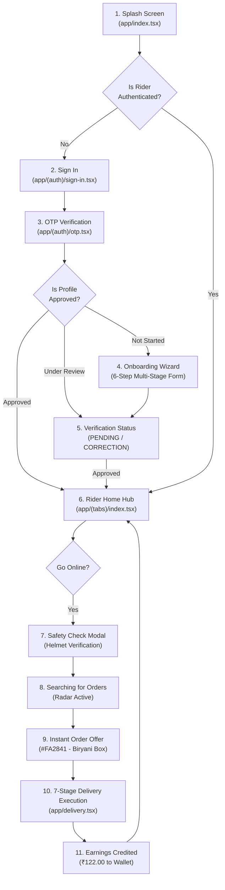

# FEAzTO Rider — Complete User & Delivery Flow

This document details the complete end-to-end user journeys in the **FEAzTO Rider** application. It serves as the standard operational flow guide for engineering, product, QA, and operations teams.

---

## 1. High-Level Architecture Journey



---

## 2. Phase-by-Phase Flow Details

### Phase A: Splash & Initialization (`app/index.tsx`)
1. App launches with dark theme canvas (`#0B0B0B`).
2. FEAzTO brand icon and yellow accent (`#F5B700`) animate into view.
3. Zustand stores initialize:
   - `authStore`: Checks persisted session / active tokens.
   - `riderStore`: Hydrates active profile details.
   - `orderStore`: Hydrates any active order in flight.
4. Auto-route decision:
   - If not signed in $\to$ Navigate to `/(auth)/sign-in`.
   - If signed in but unverified $\to$ Navigate to `/(auth)/verification-status`.
   - If signed in and approved $\to$ Navigate to `/(tabs)`.

---

### Phase B: Authentication (`app/(auth)/`)
1. **Phone Number Entry (`sign-in.tsx`)**:
   - Indian mobile prefix `+91` pre-selected.
   - Real-time 10-digit validation.
   - Terms & Privacy agreement link.
   - Pressing **"Get OTP"** transitions to OTP screen.
2. **OTP Verification (`otp.tsx`)**:
   - 4-box segmented PIN input with auto-focus.
   - 30-second countdown timer for SMS resend.
   - Quick dev shortcut ("Use 1234") provided for instant local testing.
   - On completion, verifies mock token and loads rider verification status.
3. **Verification Status (`verification-status.tsx`)**:
   - **`APPROVED`**: Instant access button to jump to active duty.
   - **`PENDING`**: Informational banner explaining 24–48 hour background check SLA with WhatsApp support shortcut.
   - **`NEEDS_CORRECTION`**: Highlighted checklist of flagged documents with direct re-upload links.

---

### Phase C: Rider Onboarding Wizard (`app/(onboarding)/`)
A 6-step zero-dead-end wizard ensuring complete compliance before duty:

1. **Personal Details (`personal-details.tsx`)**:
   - Profile selfie placeholder / upload.
   - Full legal name, date of birth, blood group, emergency contact name & relation.
2. **Driving Licence (`licence.tsx`)**:
   - 15-character DL number validation (`SS-RRYYYYYNNNNNN`).
   - Licence expiry date picker.
   - Front and reverse photo card uploads.
3. **Vehicle Details (`vehicle.tsx`)**:
   - Vehicle type selection: **EV Scooter** (highlighted with Green Surge +₹5/order bonus), **Petrol Bike**, **Bicycle**.
   - Registration number and vehicle model.
4. **Compliance Documents (`documents.tsx`)**:
   - Vehicle RC (Registration Certificate).
   - Commercial Vehicle Insurance.
   - Pollution Under Control (PUC) certificate.
5. **Bank & UPI Payouts (`bank-upi.tsx`)**:
   - Instant UPI ID field (`rider@okhdfcbank`) for direct daily payouts.
   - Bank Account Number + 11-digit IFSC code with auto branch lookup simulation (`HDFC0001234`).
6. **Summary & Final Review (`review.tsx`)**:
   - Unified review accordion displaying all 5 sections.
   - "Edit" links next to each section to make quick corrections without losing progress.
   - Dual submission options: **Submit for Review** (triggers `PENDING`) or **Instant Approval (Dev)** (triggers immediate `APPROVED` status).

---

### Phase D: Shift & Slot Booking (`app/(tabs)/shifts.tsx`)
1. **Zone Selector**: Choose operational zone (e.g., Koramangala Central, Indiranagar, HSR Layout).
2. **Day Selector**: Choose Today, Tomorrow, or Upcoming weekend.
3. **Slot Cards**:
   - Morning Breakfast Rush (07:00 – 11:00) — ₹350 guaranteed minimum.
   - Afternoon Lunch Peak (12:00 – 16:00) — ₹480 guaranteed minimum.
   - Evening Dinner Surge (19:00 – 23:30) — ₹750 guaranteed minimum + ₹25/order rain surge.
4. **Booking Action**: Confirms slot reservation, updates capacity counter, and locks shift in `slotStore`.

---

### Phase E: Duty Activation & Safety Verification (`app/(tabs)/index.tsx`)
1. **Offline State**:
   - Rider toggle is `OFFLINE`.
   - Map displays home zone heatmap with surge indicators.
   - Order matching is disabled.
2. **Duty Toggle**:
   - Sliding/Tapping "Go Online" triggers mandatory **Safety Check Modal**.
3. **Helmet & Gear Check**:
   - Modal displays safety guidelines: Helmet fastened, FEAzTO reflective jacket worn, smartphone battery $> 20\%$.
   - Rider confirms checklist $\to$ Status transitions to `ONLINE`.
4. **Radar Active**:
   - Pulsing radar radar animation appears on map.
   - Subscribes to order dispatch channel.

---

### Phase F: Order Lifecycle Execution (`app/delivery.tsx`)

The core execution path for canonical order **`#FA2841`**:

```
[1. OFFER_PENDING]
       │
       ▼ (Rider accepts offer within 30s)
[2. NAVIGATING_TO_KITCHEN] ───► Google Maps / Turn-by-Turn to "Biryani Box Cloud Kitchen"
       │
       ▼ (Arrives at Kitchen geo-fence)
[3. ARRIVED_AT_KITCHEN] ──────► Shows Order details, 3 items, Special instructions
       │
       ▼ (Kitchen hands over sealed parcel)
[4. PICKED_UP] ───────────────► Rider confirms items checked, thermal bag sealed
       │
       ▼ (Rider starts bike)
[5. NAVIGATING_TO_CUSTOMER] ──► Turn-by-Turn route to "Prestige Tech Park, Flat 402"
       │
       ▼ (Arrives at Customer gate)
[6. ARRIVED_AT_CUSTOMER] ─────► Informs customer via push notification
       │
       ▼ (Customer provides 4-digit code: "4821")
[7. OTP_VERIFICATION] ────────► Validates OTP "4821"
       │
       ▼
[8. DELIVERED] ───────────────► Shows Celebration Card, +₹122.00 added to Earnings
```

#### Order Step Details:
- **Navigation Shortcuts**: One-tap native intent opens Google Maps / Apple Maps with kitchen and customer coordinates.
- **Direct Calling**: Masked phone button connects rider to customer without exposing private numbers.
- **Order Security**: Canonical 4-digit OTP (`4821`) must be entered to finalize completion.

---

### Phase G: Rain Surge & Dynamic Incentives (`app/incentives.tsx`)
1. **Live Weather Switcher**:
   - Rider or simulated environment toggles between:
     - `NORMAL` (₹0 surge)
     - `RAIN` (+₹25 extra per order)
     - `HEAVY_RAIN` (+₹40 extra per order)
     - `HEAT` (+₹15 afternoon allowance)
     - `STORM_ALERT` (+₹60 extreme surge)
2. **Milestone Target Cards**:
   - Complete 10 orders today $\to$ ₹200 bonus (e.g., 6/10 completed).
   - Complete 18 orders today $\to$ ₹450 bonus.
   - Weekend Champion (35 orders) $\to$ ₹1,200 bonus.

---

### Phase H: Earnings & Instant UPI Cashout (`app/(tabs)/earnings.tsx`)
1. **Real-time Wallet Display**:
   - Today's Earnings (e.g., ₹1,480.00).
   - Breakdown:
     - Base Order Pay: ₹920.00
     - Rain & Peak Surges: ₹280.00
     - Milestone Incentives: ₹200.00
     - Customer Tips: ₹80.00
2. **Instant Cashout (UPI)**:
   - Tap "Withdraw to UPI (`rider@okhdfcbank`)".
   - Select amount or tap "Full Balance".
   - Executes instant simulated IMPS payout in $< 3$ seconds.
   - Deducts wallet balance and adds entry to payout history.

---

### Phase I: Safety, Wellbeing & SOS Emergency (`app/safety.tsx`)
1. **Rest Break Mode (`ON_BREAK`)**:
   - Rider can take a 15-minute hydration/rest break.
   - Pauses dispatch matching without lowering acceptance rate or attendance score.
   - Live timer counts down remaining break time.
2. **Pre-Ride Vehicle Safety Checklist**:
   - Brakes, Tyre Pressure, Headlight, Thermal Delivery Bag.
3. **Emergency SOS System**:
   - 2-step confirmation to prevent accidental triggers.
   - Broadcasts current live coordinates to FEAzTO Emergency Response Team.
   - One-tap dial button for Police (112) and National Ambulance (108).
   - Displays designated emergency contact with direct call action.
