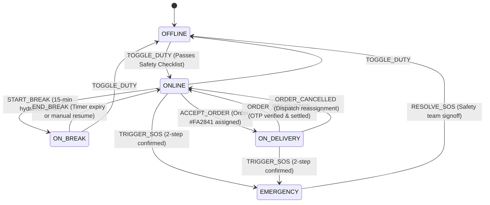
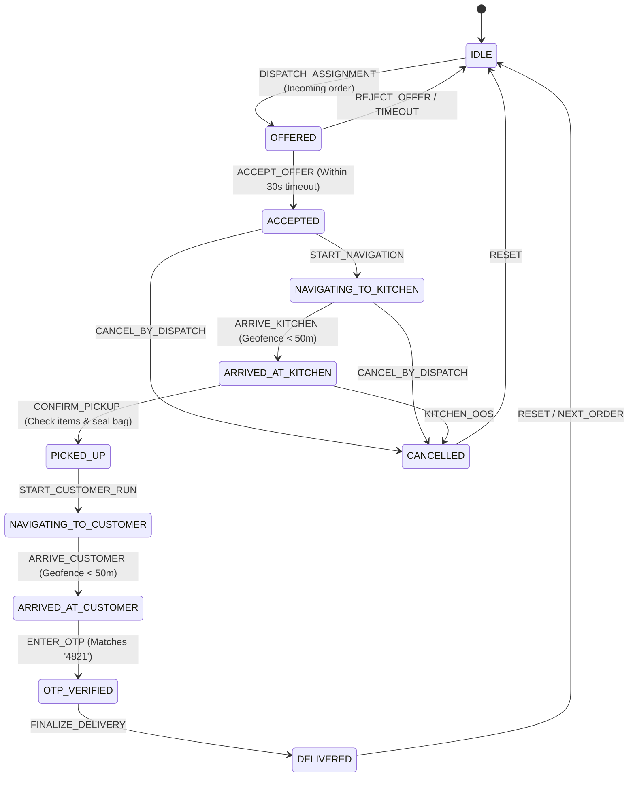
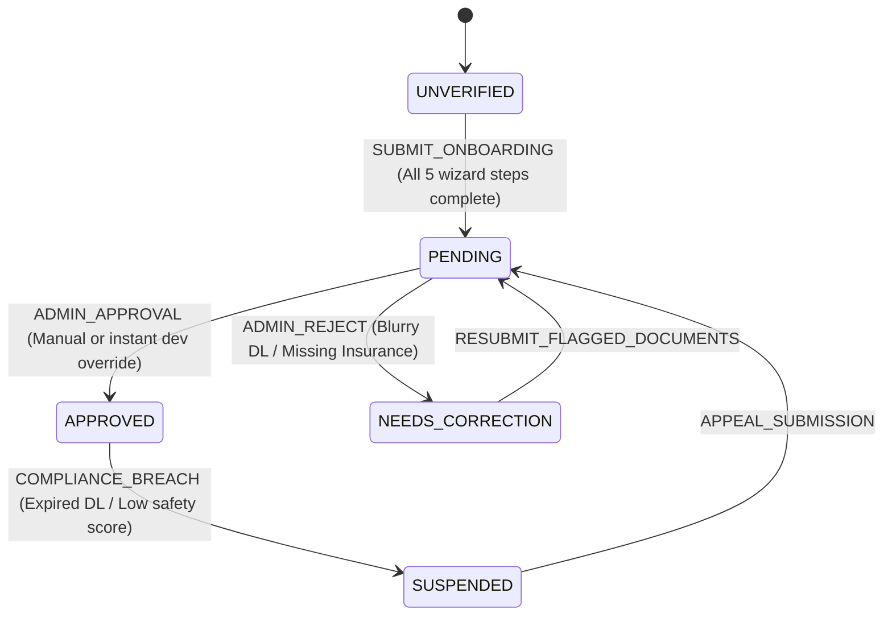
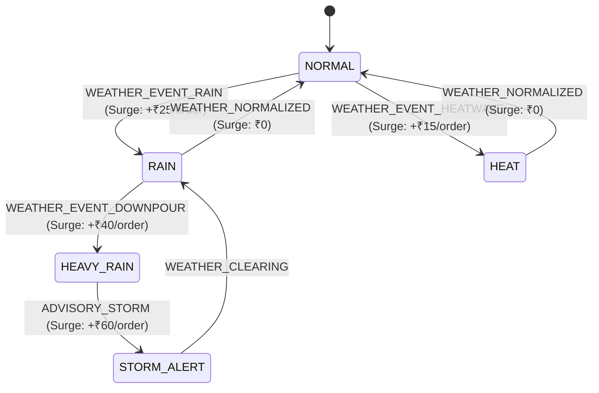
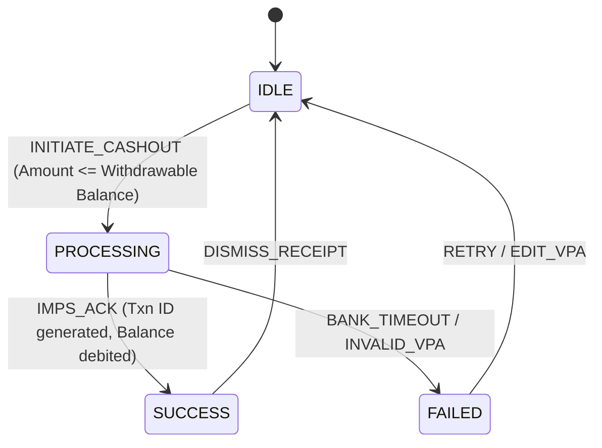

# FEAzTO Rider — State Machine Specifications

This document defines all discrete finite state machines (FSM) operating within the **FEAzTO Rider** native application. It details state spaces, valid transition triggers, forbidden transitions, and resulting side-effects across stores and services.

---

## 1. Rider Duty State Machine (`riderStore.ts`)

Controls the operational status and dispatch availability of the delivery partner.

### State Definitions & Guards
| State | Can Receive Offers? | GPS Tracking Mode | Store Flag |
| :--- | :--- | :--- | :--- |
| `OFFLINE` | No | Background / Idle | `dutyStatus: 'OFFLINE'` |
| `ONLINE` | **Yes** (Radar active) | High Accuracy (every 5s) | `dutyStatus: 'ONLINE'` |
| `ON_BREAK` | No (Protected status) | Battery Saver | `dutyStatus: 'ON_BREAK'` |
| `ON_DELIVERY` | No (Exclusive) | High Accuracy (every 3s) | `dutyStatus: 'ON_DELIVERY'` |
| `EMERGENCY` | No (Locked) | Realtime Distress Broadcast | `dutyStatus: 'EMERGENCY'` |

#### Forbidden Transitions:
- `OFFLINE` $\to$ `ON_DELIVERY` (Direct assignment while off duty is rejected by dispatch).
- `ON_BREAK` $\to$ `ON_DELIVERY` (Riders on protected rest cannot be sent offers).
- `ON_DELIVERY` $\to$ `OFFLINE` (Must either complete the order or cancel via Dispatch Support).

---

## 2. Order Lifecycle State Machine (`orderStore.ts`)

Controls the single-active-order progression from dispatch broadcast through OTP settlement.

### Transition Specifications
| From State | Event / Trigger | Target State | Side Effect / Store Action |
| :--- | :--- | :--- | :--- |
| `IDLE` | `DISPATCH_OFFER` | `OFFERED` | Show modal, start 30s timer, vibrate haptics |
| `OFFERED` | `ACCEPT_OFFER` | `ACCEPTED` | Stop timer, set `riderStore.dutyStatus = 'ON_DELIVERY'` |
| `OFFERED` | `REJECT_OFFER` | `IDLE` | Dismiss modal, release order to dispatch pool |
| `ACCEPTED` | `START_NAVIGATION` | `NAVIGATING_TO_KITCHEN` | Launch GPS turn-by-turn route to kitchen |
| `NAVIGATING_TO_KITCHEN` | `ARRIVE_KITCHEN` | `ARRIVED_AT_KITCHEN` | Show kitchen instruction card, notify restaurant |
| `ARRIVED_AT_KITCHEN` | `CONFIRM_PICKUP` | `PICKED_UP` | Checklist verified (3 items), bag sealed |
| `PICKED_UP` | `START_CUSTOMER_RUN` | `NAVIGATING_TO_CUSTOMER` | Launch GPS route to customer address |
| `NAVIGATING_TO_CUSTOMER` | `ARRIVE_CUSTOMER` | `ARRIVED_AT_CUSTOMER` | Send doorstep SMS to customer, enable call button |
| `ARRIVED_AT_CUSTOMER` | `VERIFY_OTP` (`4821`) | `OTP_VERIFIED` | Validate OTP code, show celebration modal |
| `OTP_VERIFIED` | `FINALIZE_DELIVERY` | `DELIVERED` | Credit ₹122.00 to `earningsStore`, set `dutyStatus = 'ONLINE'` |

---

## 3. Verification & Compliance State Machine (`authStore.ts`)

Governs the KYC clearance lifecycle before a delivery partner can take shifts.

### State Invariants:
- **`UNVERIFIED`**: Rider cannot toggle duty to `ONLINE`. Navigates automatically to `/(onboarding)/personal-details`.
- **`PENDING`**: Rider can view `/(auth)/verification-status`. Duty toggle disabled.
- **`NEEDS_CORRECTION`**: Highlighted badges point directly to rejected documents.
- **`APPROVED`**: Full unlocked access to `/(tabs)`.

---

## 4. Dynamic Weather Surge State Machine (`incentiveStore.ts`)

Computes real-time dynamic bonus multipliers on top of standard base pay.

### Surge Matrix:
- **`NORMAL`**: Standard rates (₹40 base + ₹12/km).
- **`RAIN`**: Standard + ₹25 weather allowance + 1.2x surge on distance.
- **`HEAVY_RAIN`**: Standard + ₹40 weather allowance + extended delivery SLA (+15 mins).
- **`HEAT`**: Standard + ₹15 hydration incentive (active 12:00 – 16:00).
- **`STORM_ALERT`**: Standard + ₹60 hazard allowance + rider opt-in requirement.

---

## 5. Instant UPI Cashout State Machine (`earningsStore.ts`)

Protects rider earnings during withdrawal requests to bank accounts or UPI VPA.

### Safety Guardrails:
- Minimum withdrawal: ₹100.
- Daily withdrawal ceiling: ₹10,000.
- Cannot cash out with active delivery in progress (`dutyStatus === 'ON_DELIVERY'`).
- Simulated settlement latency: 2,500ms with smooth loading feedback.
